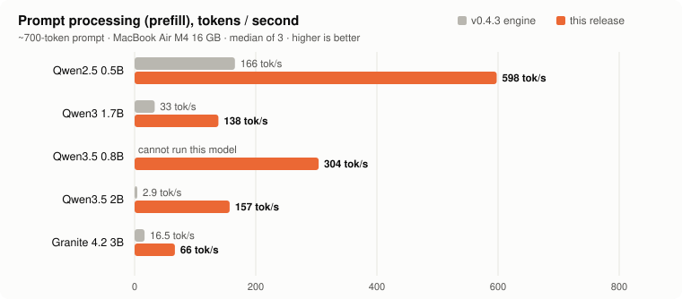
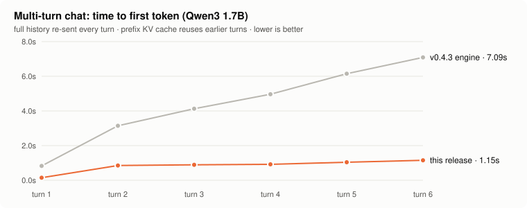
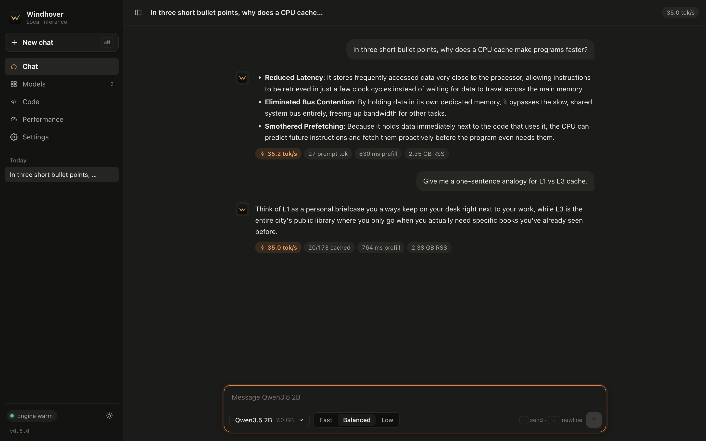
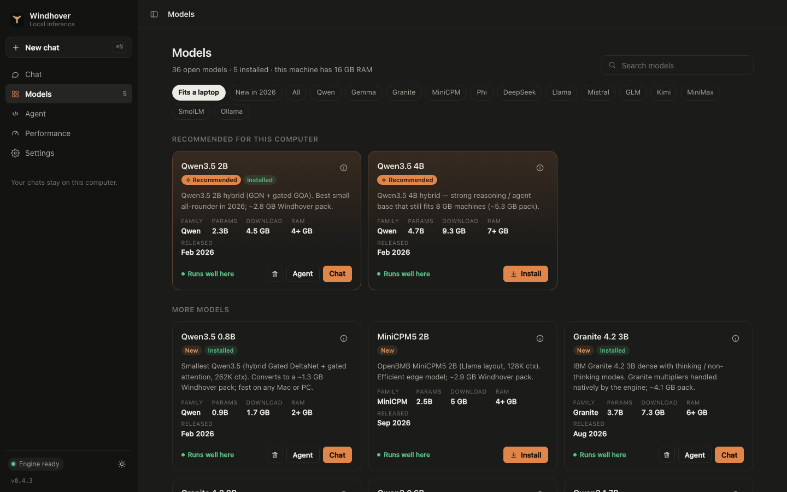
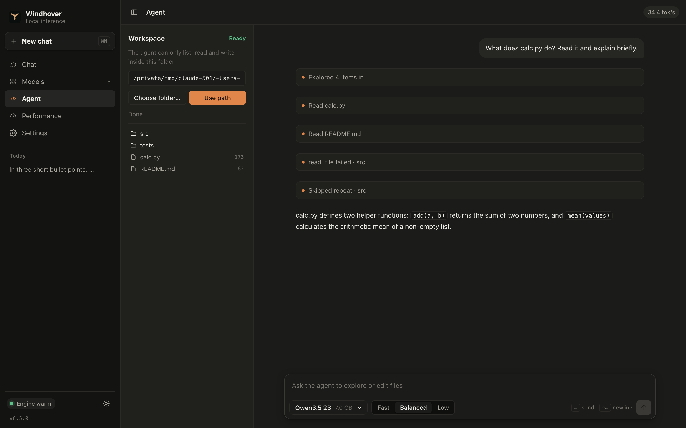
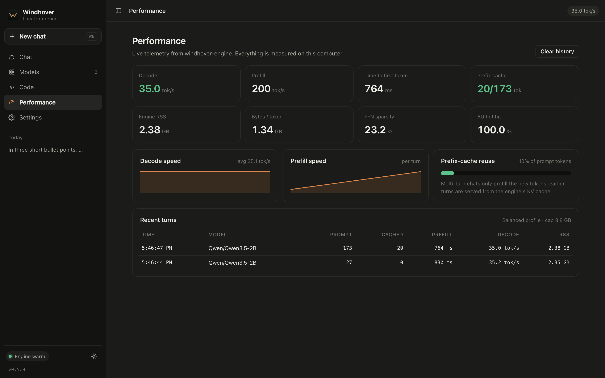
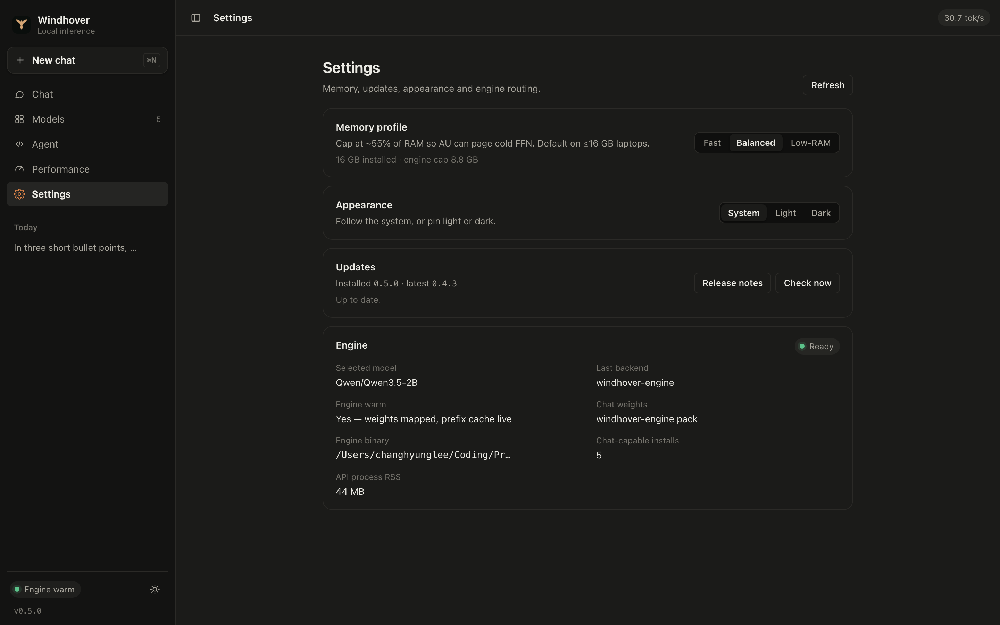

<p align="center">
  
</p>

<h1 align="center">Windhover</h1>

<p align="center">
  <strong>Local LLM runtime for macOS &amp; Windows 11</strong><br />
  Run open models with a hard RAM ceiling — sparse working-set inference on Apple Silicon and Windows.
</p>

<p align="center">
  <a href="https://github.com/cliclye/Windhover/releases/latest/download/Windhover-macOS-arm64.dmg"><strong>Download for macOS</strong></a>
  ·
  <a href="https://github.com/cliclye/Windhover/releases/latest/download/Windhover-Windows-x64.exe"><strong>Windows x64</strong></a>
  ·
  <a href="https://github.com/cliclye/Windhover/releases/latest/download/Windhover-Windows-arm64.exe"><strong>Windows ARM64</strong></a>
  ·
  <a href="https://github.com/cliclye/Windhover/releases/latest">Releases</a>
  ·
  <a href="docs/DOWNLOAD.md">Install notes</a>
  ·
  <a href="#benchmarks">Benchmarks</a>
  ·
  <a href="#how-it-works">How it works</a>
  ·
  <a href="#license">License</a>
</p>

<p align="center">
  <a href="https://github.com/cliclye/Windhover/releases/latest/download/Windhover-macOS-arm64.dmg">
    
  </a>
  <a href="https://github.com/cliclye/Windhover/releases/latest/download/Windhover-Windows-x64.exe">
    
  </a>
  <a href="https://github.com/cliclye/Windhover/releases/latest/download/Windhover-Windows-arm64.exe">
    
  </a>
</p>

---

## Why Windhover exists

On a 16 GB Mac, a stock 7B chat model in fp16 is rough:

- Weights alone are ~14 GB
- Decode is **memory-bandwidth bound**
- When RSS climbs toward the machine’s comfort zone, macOS starts swapping — and tokens/sec collapses

**Windhover** keeps a sparse working set in RAM (mmap’d KPK packs + activation-unit budgeting) so real models stay usable under a hard ceiling.

The ship binary is **`windhover-engine`**. The desktop app wraps Library · Chat · Agent · Advanced.

> All headline numbers below were measured **locally on a MacBook Air M4 · 16 GB RAM** (2026-07-22), with a **≤ 9 GB** process budget and swap-abort enabled. Not projected. Not cloud.

---

## Benchmarks

### October 2026 engine — this release vs v0.4.3

Same MacBook Air **M4 · 16 GB**, same packs, binaries interleaved run-by-run, median of 3.
Full method, raw JSON and re-run instructions: [`docs/bench/2026-10`](docs/bench/2026-10/README.md).

<picture>
  <source media="(prefers-color-scheme: dark)" srcset="docs/bench/2026-10/prefill-dark.svg" />
  
</picture>

| Model | Prompt processing (tok/s) | Chat generation (tok/s) | 6th-turn time to first token | Accuracy vs HF (KL, top-1) |
|---|---:|---:|---:|---|
| **Qwen3.5 2B** *(new)* | 3 → **157** (54×) | 2.7 → **26.7** (10×) | 174 s → **0.91 s** | 0.0065 · 5/5 |
| **Qwen3.5 0.8B** *(new)* | could not load → **304** | could not load → **50.7** | — → **0.61 s** | 0.021 · 5/5 |
| **Granite 4.2 3B** *(new)* | 16.5 → **66** (4.0×) | 12.0 → **15.6** (1.3×) | 33.5 s → **2.03 s** | 0.0086 · 5/5 (was 0.0128) |
| Qwen3 1.7B | 33 → **138** (4.2×) | 17.6 → **29.0** (1.6×) | 7.09 s → **1.15 s** | 0.031 · 5/5 (was 0.049 · 4/5) |
| Qwen2.5 0.5B | 166 → **598** (3.6×) | 37 → **126** (3.4×) | 2.13 s → **0.05 s** | 0.16 · 4/5 (was 0.23) |

<picture>
  <source media="(prefers-color-scheme: dark)" srcset="docs/bench/2026-10/ttft-dark.svg" />
  
</picture>

What changed (details in [CHANGELOG](CHANGELOG.md)):

- **Tiled int8 prefill GEMM** + transposed hi/lo down-projection → prompts 3.6–4.3× faster on dense models.
- **Prefix KV cache across chat turns** → each turn only prefills what is new; replies are byte-identical with the cache on or off.
- **Gated DeltaNet rewrite** (Qwen3.5 family) → batched + parallel instead of scalar single-thread; plus norm / q-gate correctness fixes.
- **Heap top-k sampling** → chat-temperature decoding no longer burns several ms per token on the 150k–250k vocab.
- Accuracy is measured against Hugging Face `transformers` on every model (f32 reference ≤2B, bf16 above) and is equal or better than v0.4.3 everywhere it could run.

> Absolute numbers are from a fanless laptop with normal apps open, so they drift ±10% between runs; the ratios are stable. Decode on dense int8 models is memory-bandwidth-bound (~65–75 GB/s on 4 P-cores), so its gains are modest (+5–20%); the big wins are prompt processing, multi-turn chat and the new architectures.

### July 2026 — with vs without Windhover

#### Qwen2.5-7B Instruct — with vs without Windhover

Same model: [`Qwen/Qwen2.5-7B-Instruct`](https://huggingface.co/Qwen/Qwen2.5-7B-Instruct)  
Same machine: **MacBook Air M4 · 16 GB** · budget **≤ 9 GB RSS**

| Path | Backend | Decode | Peak / mean RSS | Fits ≤ 9 GB? | Status |
|---|---|---:|---:|---|---|
| **Without Windhover** | stock `transformers` · CPU · fp16 | **0.013 tok/s** | **8.82 GB**\* | borderline | swap-bound |
| **With Windhover** | **`windhover-engine` · KPK** | **9.80 tok/s** | **4.19 GB** | **yes** | **ok** |

\*Historical thrash finish. A live without-engine attempt was **aborted at 6.44 GB RSS** after swap jumped **+1.5 GB**, to avoid cooking the machine. The 0.013 tok/s figure is from an earlier run that was allowed to finish under thrash.

**Verdict:** under a 9 GB ceiling on this M4 Air, Windhover is the usable path — about **9.8 decode tok/s at ~4.2 GB RSS**. Without it, the same 7B is effectively dead (~0.01 tok/s).

```text
Decode tok/s          Without │ 0.013  ▏
                      Windhover │ 9.80   ████████████████████████████  (~780×)

RSS vs 9 GB budget    Without │ 8.82 GB ████████████████████████░░  swap-bound*
                      Windhover │ 4.19 GB ███████████░░░░░░░░░░░░░░  fits

* Live without-engine attempt aborted at 6.44 GB RSS after +1.5 GB swap.
```


### What the gap means

| | Without | With Windhover | Δ |
|---|---:|---:|---:|
| Decode | 0.013 tok/s | **9.80 tok/s** | **~780×** |
| RSS | 8.82 GB (thrash) | **4.19 GB** | **−53%** |
| Usable chat on 16 GB Mac | no | **yes** | — |

### Host pressure (same day, same Mac)

After the without-engine swap stress, Windhover was re-run on the same machine:

| Condition | Decode | RSS |
|---|---:|---:|
| Quiet (earlier same day) | **9.80 tok/s** | 4.19 GB |
| After without-engine swap stress | 5.62 tok/s | 4.19 GB |

RSS stays flat. Throughput drops under thermal / memory pressure — honest, not hidden.


<details>
<summary>Bench notes</summary>

- Decode-only where available · greedy
- Windhover: `NGEN=32`
- Stock path: CPU fp16 via `transformers`
- Budget: ≤ 9 GB with swap abort
- Full dumps live under [`docs/`](docs/) (`qwen7b_bench.json`, related)

</details>

---

## Theory

### Decode is a bandwidth problem

LLM decode mostly streams weight bytes from memory into the CPU every token. On Apple Silicon laptops the ceiling is finite (tens of GB/s for a handful of performance cores). If every step touches a dense 7B fp16 footprint, you:

1. Blow past a healthy RAM budget
2. Enter swap
3. Watch tok/s fall off a cliff

That is exactly what “without Windhover” looks like on the M4 Air for Qwen2.5-7B.

### Sparse working set

Windhover treats a model as a set of **activation units (AUs)** under one **byte ledger**:

- **Dense models** (Qwen, Llama, …): FFN neuron bundles gated by magnitude (CATS-style sparsity)
- **MoE models**: routed experts as AUs

Hot AUs stay resident / mlocked. Cold AUs stay **mmap’d** on SSD. Kernels only touch the predicted bytes for the next token.

```text
┌──────────────┐     gate / router      ┌─────────────────┐
│  KPK pack    │ ─────────────────────▶ │  AU tiers       │
│  group-int4  │                        │  hot · warm ·   │
│  mmap weights│                        │  cold (SSD)     │
└──────────────┘                        └────────┬────────┘
                                                 │
                                                 ▼
                                        ┌─────────────────┐
                                        │ RAM ledger      │
                                        │ hard ceiling    │
                                        │ (RAM_GB / cap)  │
                                        └────────┬────────┘
                                                 │
                                                 ▼
                                        bandwidth-first
                                        CPU kernels
```

### KPK packs

Models are converted into a **KPK** on-disk format:

- Grouped int4 weights (mmap-friendly)
- Arch descriptor + tokenizer
- Hotness / gate metadata for AU placement

You download once, convert once, then run under the engine’s RAM budget instead of loading a full fp16 heap.

### Why this beats “just quantize”

Quantization helps, but a naive load still wants a large contiguous working set. Windhover’s point is **residency control**: only the active slice competes for RAM, so a 7B stays near **~4 GB RSS** on this machine instead of thrashing toward **9 GB+**.

---

## How it works

```text
┌──────────────┐     ┌──────────────┐     ┌───────────────────┐
│  Desktop app │────▶│  ./windhover │────▶│  windhover-engine │
│  Library UI  │     │  app :8000   │     │  SNAP = model dir │
└──────────────┘     └──────────────┘     └───────────────────┘
                           │
                           ├─ Library  /v1/catalog · pull · uninstall
                           ├─ Chat     /v1/chat/...
                           ├─ Agent    /api/workspace · /api/agent
                           └─ Advanced /api/stats
```

1. **Install a pack** from Library (Mac 16 GB models download real HF weights; frontier MoEs are honest about size).
2. **Convert** to KPK when needed (`./windhover convert …`).
3. **Chat / Agent** talk to `windhover-engine` with a hard RAM ceiling.
4. **Advanced** shows live RSS, tok/s, footprint, sparsity, AU hit — no silent model swap.

Numerics lineage is Apache-2.0; see [LICENSE](LICENSE).

---

## Features

| Feature | What you get |
|---|---|
| **Hard RAM ceiling** | Process stays inside a budget (`RAM_GB` / hard-cap ledger) |
| **KPK + mmap** | Group-int4 packs; cold weights stay on SSD |
| **Sparse AUs** | Dense FFN bundles + MoE experts under one working-set policy |
| **Models** | Browse / install / uninstall packs, with fit-for-this-machine hints |
| **Chat** | Markdown UI; Windhover packs + Ollama models when `ollama serve` is running |
| **Agent** | Folder-scoped tools; same model picker (Windhover or Ollama) |
| **Performance** | Live telemetry: decode/prefill tok/s, TTFT, prefix-cache reuse, RSS, sparsity, AU hit |
| **Prefix KV cache** | Multi-turn chat only prefills the new tokens |
| **Honest catalog** | No fake stubs for frontier MoEs |

---

## Screenshots

### Chat

Saved local conversations, model + memory-profile picker in the composer, per-reply speed / prefix-cache chips.



### Models

Recommended picks for this machine's RAM, 2026 models (Qwen3.5, Granite 4.2, MiniCPM5), fit hints and one-click install.



### Agent

Pick a folder; the local model lists / reads / writes under that root only.



### Performance

Live engine telemetry — decode / prefill tok/s, time to first token, prefix-cache reuse, RSS, bytes per token.



### Settings

Memory profile (Fast / Balanced / Low-RAM), theme, updates and engine routing.



---

## Install

### Easiest — download the app

- **macOS (Apple Silicon):** [Windhover-macOS-arm64.dmg](https://github.com/cliclye/Windhover/releases/latest/download/Windhover-macOS-arm64.dmg)
- **Windows 11 x64:** [Windhover-Windows-x64.exe](https://github.com/cliclye/Windhover/releases/latest/download/Windhover-Windows-x64.exe)
- **Windows 11 ARM64:** [Windhover-Windows-arm64.exe](https://github.com/cliclye/Windhover/releases/latest/download/Windhover-Windows-arm64.exe)

See [docs/DOWNLOAD.md](docs/DOWNLOAD.md) for Gatekeeper / SmartScreen notes on unsigned builds.

> GitHub repo is **Windhover** (`cliclye/Kestrel` redirects here).

### From source

```bash
git clone <repo> && cd Windhover   # folder may still be named Kestrel
./windhover build
cd app && npm ci && npm run build && cd ..
cd desktop && cargo tauri build --bundles app,dmg   # macOS
# Windows: stage packaging/build_sidecar.ps1 then cargo tauri build --bundles nsis
```

Dev: `cd desktop && cargo tauri dev` (starts or reuses `./windhover app` on `:8000`).

---

## Quick start (CLI)

```bash
./windhover build
./windhover doctor
./windhover pull Qwen/Qwen2.5-7B-Instruct --weights
./windhover convert ~/.windhover/models/Qwen__Qwen2.5-7B-Instruct
./windhover app                 # http://127.0.0.1:8000
```

```bash
./windhover chat --model ~/.windhover/models/Qwen__Qwen2.5-7B-Instruct/kpk \
  --prompt "Hello" --ngen 64
```

```bash
./windhover bench --windhover
./windhover uninstall Qwen/Qwen2.5-7B-Instruct
```

Model home: `~/.windhover/models` (falls back to `~/.kestrel/models` if present).  
(`./kestrel` remains a thin shim to `./windhover`.)

---

## Layout

| Path | Role |
|------|------|
| [`engine/`](engine/) | **`windhover-engine`** (MoE + dense KPK) |
| [`engine/runtime/windhover.c`](engine/runtime/windhover.c) | Dense Windhover runtime |
| [`tools/kestrel_pack.py`](tools/kestrel_pack.py) | HF → KPK converter |
| [`windhover`](windhover) | CLI + Library / Chat API |
| [`app/`](app/) | Vite / React UI |
| [`desktop/`](desktop/) | Tauri macOS app |
| [`docs/`](docs/) | Benches and notes |

---

## Requirements

- **macOS 12+** · **Apple Silicon recommended**
- Headline benches: **MacBook Air M4 · 16 GB**
- Xcode CLT · Rust (Tauri) · Node 18+ (from source)
- Python 3.10+ with `torch` + `transformers` for preview / convert (`c/.venv`)
- Optional: Hugging Face CLI for `--weights` pulls

---

## License

Apache-2.0 — see [LICENSE](LICENSE).
